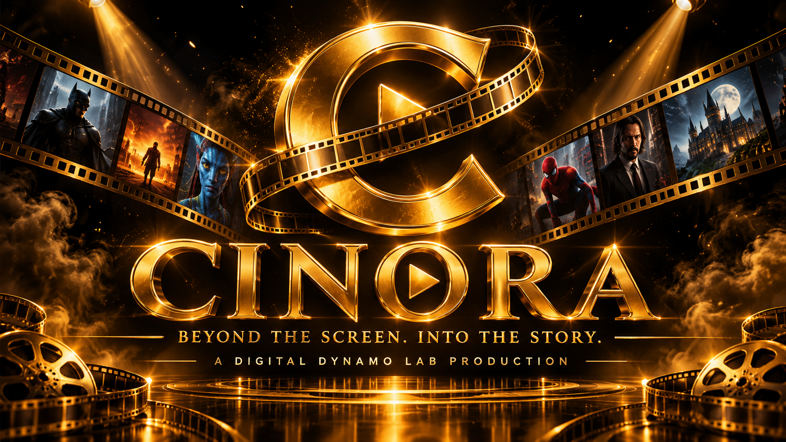

<!-- =====================================================
     CINORA — OFFICIAL PROJECT README
     A DIGITAL DYNAMO LAB PRODUCTION
     ===================================================== -->

<div align="center">



<br>

# CINORA

### BEYOND THE SCREEN. INTO THE STORY.

**A CINEMATIC STREAMING EXPERIENCE**

Discover worlds. Experience unforgettable moments. Find your next obsession.

<br>

<a href="https://cinora-p8s2.vercel.app/">
  
</a>

<a href="https://github.com/Rockykid02/Cinora">
  
</a>

<br><br>


</div>

---

# 🎬 THE CINORA EXPERIENCE

**Welcome to CINORA.**

Cinema is more than entertainment. It is emotion, imagination, adventure and storytelling.

CINORA is an independent movie and television discovery and streaming platform created to bring these experiences together through a sophisticated, immersive digital environment.

Designed with a premium cinematic aesthetic, CINORA combines a dark interface, metallic-gold identity, entertainment discovery and a responsive browsing experience.

From discovering hidden gems to revisiting your favourite stories, CINORA is built around one simple idea:

> **The experience of finding something unforgettable should feel just as exciting as watching it.**

This is not simply another movie catalogue.

**This is CINORA.**

---

# ✨ EXPLORE THE FEATURES

<table>
<tr>
<td width="50%" valign="top">

### 🎞️ CINEMATIC DISCOVERY

Explore movies and television shows through an immersive entertainment interface.

### 🔍 SMART DISCOVERY

Search for movies and television content and discover new titles.

### ❤️ MY LIST

Save titles to your personal collection and revisit them whenever you want.

</td>
<td width="50%" valign="top">

### ▶️ CONTINUE WATCHING

Keep track of viewing progress and return to titles you've started.

### 📺 MOVIE & SERIES DETAILS

Explore available descriptions, artwork, ratings and entertainment metadata.

### 📱 INSTALLABLE EXPERIENCE

Install CINORA as a Progressive Web App on compatible mobile devices.

</td>
</tr>
</table>

---

# 🖤 THE CINORA DESIGN LANGUAGE

CINORA's visual identity is built around luxury, atmosphere and cinematic storytelling.

### THE COLOUR PALETTE

| Colour | Hex | Identity |
|---|---|---|
| Deep Black | `#030303` | Primary background |
| Charcoal | `#101010` | Interface surfaces |
| Dark Bronze | `#8C4F13` | Deep metallic accents |
| Antique Gold | `#B87920` | Brand detailing |
| Rich Gold | `#D99A27` | Signature gold |
| Bright Gold | `#FFC247` | Highlights |
| Champagne | `#FFE3A1` | Premium lighting |
| Ivory | `#F5F0E7` | Light typography |

### DESIGN PHILOSOPHY

- A sophisticated black-and-gold visual identity.
- Cinematic artwork and atmospheric presentation.
- Elegant typography and carefully considered spacing.
- Responsive layouts for different screen sizes.
- A consistent visual experience across the platform.

---

# ⚡ BUILT WITH TECHNOLOGY

CINORA uses modern web technologies to deliver its experience.

| Technology | Role |
|---|---|
| HTML5 | Application structure |
| CSS3 | Styling and responsive design |
| JavaScript | Application functionality |
| Vite | Development and production build |
| TMDB API | Movie and television metadata |
| Service Workers | Caching and offline app shell |
| Web App Manifest | Installable PWA configuration |
| Vercel | Hosting and deployment |

---

# 📂 PROJECT ARCHITECTURE

```text
CINORA/
│
├── public/
│   ├── assets/
│   │   └── cinora-master.PNG
│   │
│   ├── icons/
│   │   ├── cinora-192.png
│   │   └── cinora-512.png
│   │
│   ├── manifest.webmanifest
│   └── service-worker.js
│
├── src/
│   ├── styles/
│   │   └── main.css
│   │
│   └── js/
│       ├── api/
│       │   └── tmdb.js
│       │
│       ├── utils/
│       │   └── storage.js
│       │
│       └── app.js
│
├── api/
│   └── tmdb.js
│
├── index.html
├── package.json
├── vite.config.js
├── vercel.json
├── .env.example
└── README.md
```

---

# 🚀 RUN CINORA LOCALLY

Want to explore the source code or run your own development environment?

### REQUIREMENTS

- Node.js
- npm
- A TMDB API key

### 01 — CLONE THE REPOSITORY

```bash
git clone https://github.com/Rockykid02/Cinora.git
```

### 02 — ENTER THE PROJECT

```bash
cd Cinora
```

### 03 — INSTALL DEPENDENCIES

```bash
npm install
```

### 04 — CONFIGURE YOUR ENVIRONMENT

Create a `.env` file in the project root.

```env
TMDB_API_KEY=your_tmdb_api_key
```

Use your own valid TMDB API key.

Never publish private API credentials in a public repository.

### 05 — START DEVELOPMENT

```bash
npm run dev
```

### 06 — BUILD FOR PRODUCTION

```bash
npm run build
```

The production build is generated in the `dist` directory.

---

# 📱 CINORA ON YOUR DEVICE

CINORA supports installation as a Progressive Web App on compatible devices.

### IPHONE & IPAD

1. Open CINORA using Safari.
2. Tap the Share icon.
3. Select **Add to Home Screen**.
4. Keep the CINORA name.
5. Tap **Add**.

### ANDROID

1. Open CINORA in a supported browser.
2. Open the browser menu.
3. Select **Install App** or **Add to Home Screen**, when available.
4. Follow the installation instructions.

### THE RESULT

Enjoy CINORA from your device's home screen with an app-like standalone experience.

**Note:** Installation does not make online streaming available offline. An internet connection is required for online entertainment, metadata and playback.

---

# 🌐 ENTER THE CINORA WORLD

<div align="center">

### YOUR NEXT STORY STARTS HERE.

<a href="https://cinora-p8s2.vercel.app/">
  
</a>

<br><br>

**LIVE PLATFORM**

https://cinora-p8s2.vercel.app/

**SOURCE CODE**

https://github.com/Rockykid02/Cinora

</div>

---

# 🏆 THE PEOPLE BEHIND THE VISION

<div align="center">

## CREATED BY

# SAGE DICKSON

**FOUNDER & CREATIVE DIRECTOR**

### CONCEPT & CREATIVE DIRECTION
SAGE DICKSON

### BRAND & PLATFORM DEVELOPMENT
DIGITAL DYNAMO LAB

<br>

**A DIGITAL DYNAMO LAB PRODUCTION**

</div>

---

# ⚖️ ACKNOWLEDGEMENTS

CINORA uses TMDB for movie and television metadata and associated entertainment information.

This product uses the TMDB API but is not endorsed or certified by TMDB.

Movie and television artwork, trademarks and related intellectual property belong to their respective owners.

CINORA is an independent project. Availability of third-party playback services and content is subject to the respective providers' terms, permissions and rights.

---

<div align="center">


<br><br>

# CINORA

### BEYOND THE SCREEN. INTO THE STORY.

**A DIGITAL DYNAMO LAB PRODUCTION**

<br>

© 2026 CINORA. ALL RIGHTS RESERVED.

<sub>EVERY STORY DESERVES TO BE EXPERIENCED.</sub>

</div>
